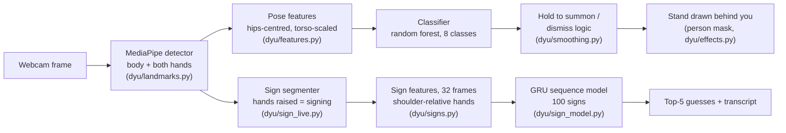
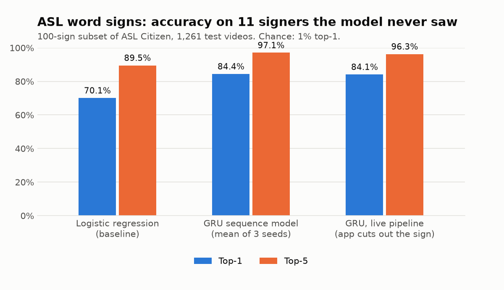
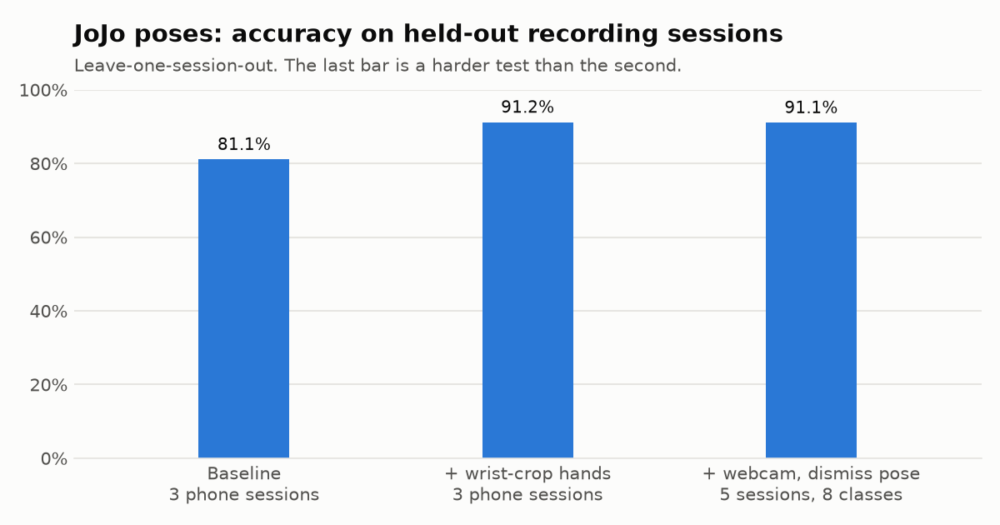

# Do You UnderSTAND

[](https://github.com/Neo-Land/DoYouUnderSTAND/actions/workflows/tests.yml)

Real-time body and hand recognition from a webcam, built on MediaPipe landmarks, in two modes:

- **JoJo poses.** Strike a pose from *JoJo's Bizarre Adventure* and hold it: that character's Stand appears behind you, with ゴゴゴ menacing text and a sound. It stays until you dismiss it.
- **ASL word signs.** Recognizes isolated American Sign Language signs, trained and tested on Microsoft Research's ASL Citizen dataset, with accuracy reported on signers the model has never seen.

The name is a pun on both: do you *understand* (ASL), do you have a *Stand* (JoJo).

## Demo

*Demo video coming soon: summoning, switching and dismissing Stands, then live ASL signing with the top-5 guesses.*

## How it works

Both modes share one landmark detector; everything after it is specific to the mode.



## Results at a glance

| Mode | What | Result |
| --- | --- | --- |
| JoJo poses | 6 poses + normal movement + dismiss, 5 recording sessions | **91.1%** accuracy, macro-F1 0.921 (leave-one-session-out) |
| JoJo poses, live logic | replaying every clip through the app | **0 false summons** during normal movement; 24/24 pose clips summon (median 1.8 s) |
| JoJo poses, speed | 1280×720 webcam frame, desktop CPU | **~20 fps** |
| ASL word signs | 100-sign subset of ASL Citizen, 11 test signers never seen in training | **84.4% top-1, 97.1% top-5** with a GRU (chance 1%; baseline 70.1%) |
| ASL, live pipeline | signs found and cut out of the stream by the app | sign detected in 98.7% of test videos; 84.1% top-1 |

<p align="center">
  
  
</p>

The ASL numbers are on a 100-sign subset, so they are not comparable with published results on ASL Citizen's full 2,731-sign vocabulary (about 62% top-1 for the dataset authors' baselines). Details, design choices and how each number was measured: [docs/poses.md](docs/poses.md) and [docs/signs.md](docs/signs.md). Every experiment, with before and after numbers: [docs/DEVLOG.md](docs/DEVLOG.md).

## Quick start

Python 3.11. Windows:

```powershell
git clone https://github.com/Neo-Land/DoYouUnderSTAND.git
cd DoYouUnderSTAND
./setup.ps1                     # creates .venv, installs requirements and the dyu package
.\.venv\Scripts\Activate.ps1
```

Mac/Linux: `./setup.sh`, then `source .venv/bin/activate`.

The JoJo app needs a trained pose model, and the training clips aren't in the repo (they're personal recordings). With your own clips in `data/videos/` (see [docs/poses.md](docs/poses.md#training-your-own-model)):

```powershell
python scripts/poses/extract_landmarks.py   # clips -> data/landmarks.csv
python scripts/poses/train.py               # -> models/pose_classifier.joblib, reports/poses/
python app.py                               # webcam; --video <clip> to play a recording, --debug for the skeleton
```

Hold a pose for about 1.5 s to summon its Stand; raise both arms in a "Y" for about 1 s to dismiss it. MediaPipe's model files (~30 MB) download into `models/` on the first run.

ASL mode: `python app.py --mode signs` (needs a sign model trained on ASL Citizen, see [docs/signs.md](docs/signs.md#reproducing)). Sign one word with your hands raised, lower them, and the top 5 guesses appear.

## Project structure

```
app.py                      live demo: --mode poses (JoJo, default) or --mode signs (ASL)
config.yaml                 every setting: camera, extraction, recognition, effects, Stands, ASL signs
dyu/                        the shared library (see dyu/__init__.py for a module map)
  landmarks.py              MediaPipe wrapper: body + hands per frame, wrist-crop fallback, person mask
  features.py               JoJo pose features, mirroring, framing check
  pose_model.py             JoJo classifiers and feature matrices (shared by training and evaluation)
  smoothing.py              hold-to-summon / dismiss logic
  live_eval.py              replays recorded clips through the app's live logic
  effects.py                Stand rendering, ゴゴゴ text, sound
  signs.py                  ASL sign features: body-relative hands, trimming, resampling
  sign_model.py             ASL GRU sequence classifier (PyTorch)
  sign_live.py              ASL live mode: cut the stream into signs, classify each
  clips.py, config.py       clip-name parsing, config loading
scripts/
  poses/                    extract_landmarks, train, eval_live, tune_smoothing, render_stand_previews
  signs/                    extract_asl_citizen, extract_landmarks, train, eval_live
tests/                      unit tests (pytest), run with ruff in CI on every push
reports/                    committed results: poses/ (metrics, confusion matrix, live eval), signs/
docs/                       poses.md, signs.md, DEVLOG.md, figures/ (charts from scripts/make_figures.py)
assets/, data/, datasets/, models/   local only, git-ignored (art, recordings, datasets, trained models)
```

## Development

```powershell
python -m pytest -q     # unit tests
python -m ruff check .  # lint
```

Both run in GitHub Actions on every push. Each script starts with a docstring explaining what it reads, what it writes and how to run it; `python <script> --help` prints the same.

## Data and licensing

- **Recordings** of the JoJo poses are personal and aren't published.
- **Stand art and sounds** are fan material and stay local (`assets/` is git-ignored). *JoJo's Bizarre Adventure* characters and Stands belong to Hirohiko Araki / Shueisha; this is a non-commercial fan project.
- **ASL Citizen** (Desai et al. 2023, arXiv:2304.05934; [citation](docs/signs.md#citation)) is used under its Microsoft Research license for non-commercial research. The videos, the landmarks extracted from them and models trained on them are never committed or published; only code and accuracy numbers are. See [docs/signs.md](docs/signs.md#license).

## Roadmap

- [x] JoJo poses: recognition, Stand effects, hold-to-summon and dismiss, tested live on a webcam
- [x] ASL word signs: landmarks for 100 signs, baseline at 70.1% top-1 on unseen signers
- [x] ASL: a GRU sequence model: 84.4% top-1 / 97.1% top-5 on unseen signers
- [x] ASL: a live word-sign mode in the app with top-5 predictions
- [ ] ASL: a larger vocabulary
- [ ] A short demo video
